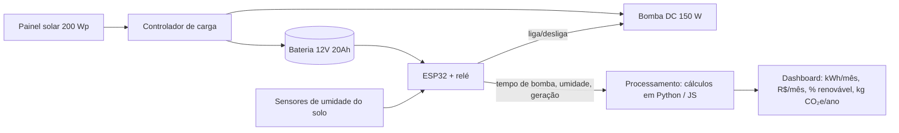

# Horta Comunitária Solar | SERS | Global Solution 2026.2

**Disciplina:** Soluções em Energias Renováveis e Sustentáveis (SERS), Ciência da Computação 1CCPB, FIAP
**Desafio:** Neighborhood Action Dashboard (CitizenTech)

**Integrantes**
- Victor Hugo Astorino, RM 575927
- Lucas Jorge Ferreira, RM 575223
- Gabriel De Paula Santa Izabel, RM 576143

> Contribuição de SERS: pasta `sers/` (cálculos, comparação, diagrama e `dashboard.html`).

## 1. Descrição da solução
Propomos automatizar a irrigação por gotejamento de uma horta comunitária com **sensores de umidade do solo** e alimentar a bomba por um **sistema fotovoltaico isolado** (painel, controlador de carga e bateria). Um microcontrolador (ESP32) liga a bomba só quando o solo está seco. Os dados de tempo de bomba e geração alimentam o **dashboard**, que mostra consumo, economia, custo, percentual renovável e emissões evitadas. Comparamos essa solução (B) com uma alternativa de menor custo, que mantém a rede elétrica e usa só os sensores (A), e com o cenário atual (base).

## 2. Diagnóstico
- **Espaço:** horta comunitária urbana de ~200 m² (São Paulo, SP).
- **Problema:** a bomba elétrica de 370 W é ligada por timer fixo (2 h/dia), sem considerar a umidade do solo. Há desperdício de energia e de água, e a horta depende de um ponto de energia da rede.
- **Público:** moradores que cultivam e consomem os alimentos da horta, escolas e famílias do entorno.
- **Funcionamento:** irrigação diária por gotejamento, 30 dias/mês.

## 3. Consumo (E = P × t / 1000, base de 30 dias)
| Item | P (W) | t (h/dia) | E (kWh/mês) |
|---|---|---|---|
| Bomba 370 W, timer fixo (base) | 370 | 2,0 | 22,20 |
| Bomba 370 W com sensor (−30% de tempo) | 370 | 1,4 | 15,54 |
| Bomba DC 150 W com sensor | 150 | 1,4 | 6,30 |
| Controlador ESP32 + sensores + relé | 3 | 24 | 2,16 |

## 4. Dados utilizados e fontes
| Dado | Valor | Fonte |
|---|---|---|
| Tarifa | R$ 0,95/kWh | Faturas B1 Residencial da Enel SP em 2026 mostram TUSD ≈ 0,5165 + TE ≈ 0,3496 = R$ 0,866/kWh com tributos (bandeira verde). Aplicamos o reajuste médio de 10,18% aprovado pela ANEEL em jul/2026 (o efeito exato na B1 deve ser conferido). |
| Fator de emissão | 0,0385 kg CO₂e/kWh | Média anual do SIN em 2023: 38,5 kg CO₂/MWh (MCTI). |
| Irradiação | 4,2 kWh/m²·dia (média anual); 2,9 no pior mês | Atlas Brasileiro de Energia Solar (INPE). Valores do litoral paulista (Santos), usados como aproximação conservadora para São Paulo. Confirmar para o endereço no CRESESB SunData. |
| Performance ratio | 0,75 | Premissa usual de projeto (perdas de temperatura, cabos e controlador). |
| Redução do tempo de bomba | 30% | Estudo na horta da ETEC de Adamantina/SP mediu cerca de 30% de economia de água com irrigação automatizada. Premissa nossa: tempo de bomba proporcional ao volume de água. Outro estudo (IFMS, 2024) relata até 50%. |
| Custo de sensores e controlador | R$ 350 | O projeto da ETEC cita Arduino R$ 80, sensor R$ 30, DHT22 R$ 40, relé R$ 20, válvula R$ 50 e display R$ 40, somando R$ 260; adicionamos materiais de caixa e prototipagem. |
| Custo do painel | ~R$ 450 | Anúncios de painel flexível de 200 W: kit com 2 por R$ 823 a 929 (Mercado Livre). |
| Controlador de carga, bomba DC e bateria | R$ 250, 450 e 300 | **Estimativas nossas, sem orçamento.** A confirmar em lojistas. |

## 5. Comparação (mesma necessidade: irrigar 200 m², 30 dias)
| | Base | A: rede + sensores | B: solar + sensores |
|---|---|---|---|
| Consumo (kWh/mês) | 22,20 | 17,70 | 8,46 |
| Da rede (kWh/mês) | 22,20 | 17,70 | 0 |
| Economia da rede | , | 4,50 kWh (20,3%) | 22,20 kWh (100%) |
| Economia (R$/mês) | , | 4,27 | 21,09 |
| CO₂e evitado (kg/ano) | , | 2,08 | 10,26 |
| Renovável | 0% | 0% | 100% |
| Implantação (R$, estimado) | 0 | 350 | 1.850 |
| Retorno simples (meses) | , | ~82 | ~88 |

**Dimensionamento de B:** painel de 200 Wp × 4,2 × 0,75 × 30 dias ≈ **18,9 kWh/mês**, contra demanda de 8,46 kWh/mês. No pior mês (2,9 kWh/m²·dia) o painel ainda gera ≈ 13,05 kWh/mês. A bateria de 12 V/20 Ah (≈ 240 Wh) mantém o controlador ligado à noite (36 Wh).

| | Benefícios | Limitações |
|---|---|---|
| A | Barata, simples, reduz água e energia | Continua dependente da rede e não é renovável |
| B | 100% renovável, funciona sem rede, valor educativo | Custo inicial maior, retorno longo, sobra de geração, manutenção da bateria |

**Conclusão:** B é a proposta principal. O retorno financeiro é parecido com o de A (7 a 7,5 anos), mas só B elimina a dependência da rede, usa fonte renovável e dispensa ligar a horta à rede. A é a alternativa de transição de baixo custo. Com tarifa e fator de emissão atuais, o ganho de dinheiro e de CO₂ é pequeno em valores absolutos. O argumento forte é autonomia, água economizada e valor educativo.

## 6. Viabilidade técnica e condições necessárias
- **Sol:** painel voltado para o norte, inclinação próxima à latitude de São Paulo (~23°), sem sombra entre 9h e 15h. A geração no pior mês (13 kWh) ainda cobre a demanda (8,5 kWh).
- **Água:** reservatório ou caixa elevada e ponto de captação (rede, cisterna ou poço), com tubulação de gotejamento instalada.
- **Eletrônica:** ESP32 e sensores capacitivos em caixa à prova d'água; leituras enviadas por Wi-Fi ao dashboard (alternativa: cartão SD, se não houver internet).
- **Segurança:** painel e bateria em local protegido contra furto, com fusível e proteção contra inversão de polaridade.
- **Manutenção:** limpar o painel periodicamente, calibrar sensores a cada safra e trocar a bateria em ~3 a 5 anos.
- **Operação:** um grupo de voluntários responsável por checar o sistema, já que não há equipe técnica fixa.

## 7. Impactos ambientais
- **Emissões:** B evita ~10,3 kg CO₂e/ano e A, ~2,1. O valor é baixo porque a matriz elétrica brasileira já é bastante renovável.
- **Água:** a automação reduz o desperdício. Com 30% de economia e rega de 2 h/dia, é a principal vantagem ambiental, ainda que não quantificada em litros neste trabalho (falta a vazão do gotejamento).
- **Resíduos:** a bateria de chumbo-ácido (ou lítio) e o painel têm descarte específico. A bateria deve ir a ponto de logística reversa e o painel dura 25 anos ou mais. Eletrônicos (ESP32, sensores) também precisam de descarte adequado.
- **Fabricação:** painel, bateria e eletrônicos têm pegada de carbono própria, não contabilizada aqui. O retorno ambiental desse investimento é longo.
- **Uso do solo:** a área do painel é de ~1,2 m², sem impacto relevante.

## 8. Benefícios para a comunidade
- Alimento mais barato e fresco para as famílias da horta.
- Menos trabalho manual de rega e menos perda de plantas por falta ou excesso de água.
- Espaço de educação ambiental: escolas do entorno podem acompanhar o dashboard e aprender sobre energia solar e automação.
- Transparência: os indicadores ficam visíveis para toda a comunidade.
- Replicabilidade: o modelo serve a outras hortas, praças e pontos de ônibus sem rede elétrica.

## 9. Diagrama da solução

## 10. Indicadores (no `dashboard.html`)
| Indicador | Unidade | Cálculo |
|---|---|---|
| Consumo de energia | kWh/mês | Σ P×t/1000 |
| Economia energética da rede | kWh/mês e % | base − consumo da rede |
| Redução de custo | R$/mês | economia × tarifa |
| Participação de energia renovável | % | consumo solar / consumo total |
| Emissões evitadas | kg CO₂e/ano | economia × 12 × fator |

## 11. Arquivos
- `calculos.py`: cálculos e geração do `dados.json` (`python calculos.py`).
- `dashboard.html`: dashboard com deslizadores de horas, tarifa e fator de emissão (abrir no navegador).
- `dados.json`: resultados dos cenários.

## 12. Referências
- MCTI, fator médio de emissão do SIN em 2023: https://www.gov.br/mcti/pt-br/acompanhe-o-mcti/noticias/2024/02/fator-de-emissao-de-co2-na-geracao-de-energia-eletrica-no-brasil-em-2023-e-o-menor-em-12-anos
- Reajuste da Enel SP (jul/2026): https://cenarioenergia.com.br/2026/06/30/aneel-aprova-reajuste-da-enel-sao-paulo-com-efeito-medio-de-1018/
- Faturas Enel SP B1 Residencial 2026 (Câmara dos Deputados, cota parlamentar), por exemplo: https://www.camara.leg.br/cota-parlamentar/documentos/publ/1402/2026/8090480.pdf
- Atlas Brasileiro de Energia Solar (INPE) citado em: https://anaiscbens.emnuvens.com.br/cbens/article/download/1129/1132/1134 e CRESESB SunData: http://www.cresesb.cepel.br/sundata/index.php
- Irrigação automatizada em horta escolar (ETEC Adamantina/SP): https://publicacoescgesg.cps.sp.gov.br/interagro/article/download/872/924/1550
- Irrigação por gotejamento com sensor (IFMS, 2024): https://sistemas.ifms.edu.br/semanadetecnologia/anais/2024/fecioeste/pdf/2463.pdf
- Preço de painel de 200 W: https://lista.mercadolivre.com.br/kit-painel-solar-para-motorhome

*Acessos feitos em nov/2026. Conferir os links antes da entrega.*

## 13. Limitações
Os valores são projeções condicionadas às premissas acima, não resultados garantidos. A redução de 30% é de um estudo de água em outra horta e foi aplicada ao tempo de bomba. Preços de controlador, bomba DC e bateria não têm orçamento. A irradiação vem de uma cidade do litoral. Não foram dimensionados a hidráulica, a sombra no local nem a degradação do painel, e a pegada de fabricação não foi contabilizada. Os dados do dashboard são simulados.
